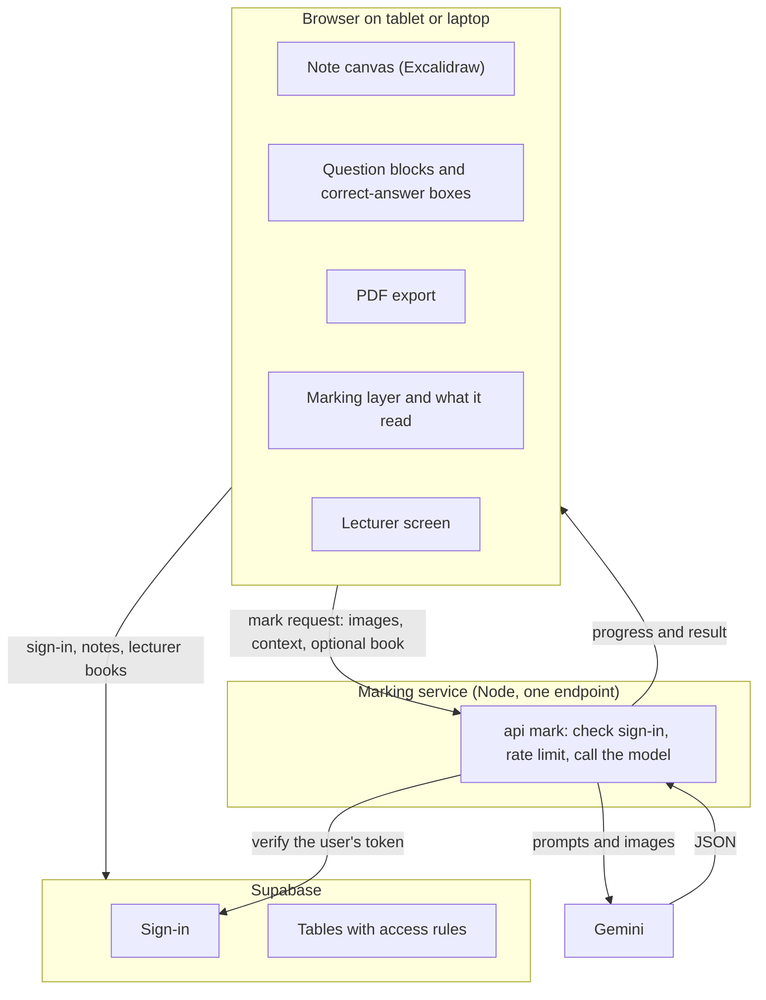
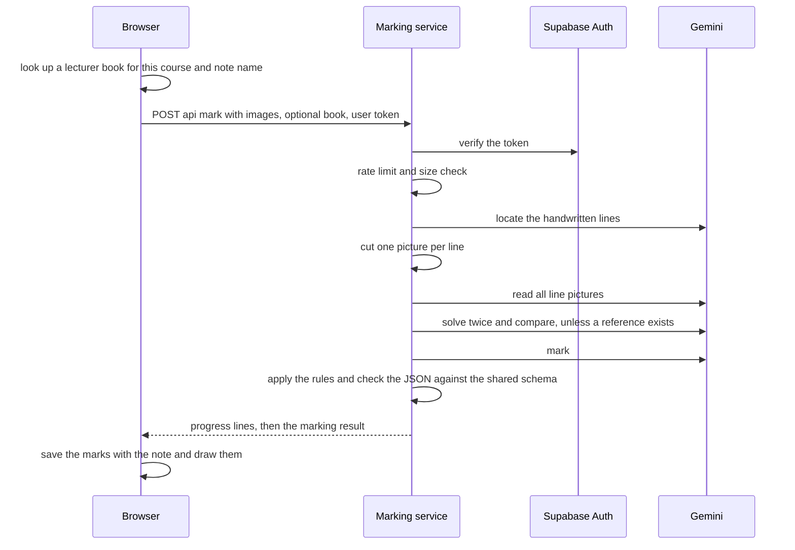
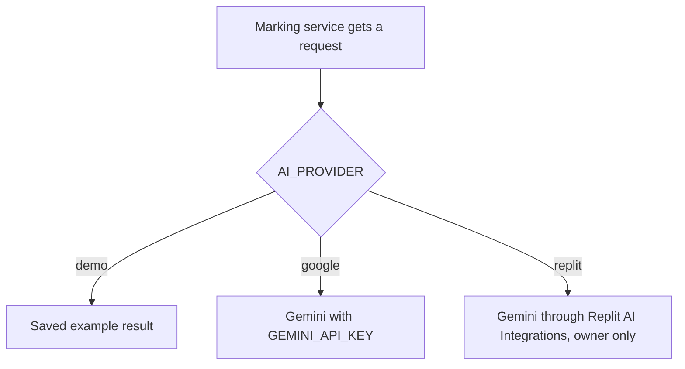

# Architecture

How the built app fits together. Checked against the code on 2026-11-06.

## Parts

## The marking call

The reply streams as NDJSON so the app can show progress. How each step works is in MARKING.md.

## Parts in words

- **Canvas.** Excalidraw supplies pen, eraser, undo, zoom, scroll, text and image paste. Handwriting is stored as strokes, not text.
- **Question block.** A pasted question picture. The answer region is everything written below it, up to the next block.
- **Correct-answer box (optional).** Typed text or a picture, on a block.
- **Lecturer answer book.** One per paper (course code and exam). Text up to 30000 characters, or one picture. A signed-in student's Mark finds it by course name and note name, cleaned the same way on both sides (`shared/src/question-key.ts`). If a book is found it is used first, then the student's own correct answer, then the AI solves the question itself.
- **Marking service.** `marking-service/`, a small Node server. It can run anywhere with a Google AI Studio key. Replit is an optional way to pay for the model. `AI_PROVIDER=demo` never calls an AI.
- **Shared.** `shared/` holds the marking result shape and the key cleaning, used by both the app and the service.
- **Supabase.** Sign-in and the tables below.

## Data

Migrations are in `supabase/migrations/` (run in order). Every table has access rules.

| Table | Holds | Who can see it |
|---|---|---|
| courses, years | the user's list. A year is the note. Free-text names | owner only |
| pages | the note: strokes, images, saved marks and correct answers (JSON) | owner only |
| papers, question_blocks, markings | created by migration 0001, not used by the app yet | owner only |
| profiles | role: student or lecturer. No one can write it from the app | own row only |
| bank_solutions | the lecturer's answer books, with version and withdrawn flag | every signed-in user reads live books. Only the author (a lecturer) changes or withdraws. No delete |
| app_secrets, lecturer_claim_attempts | the lecturer code hash and the tries | nobody from the app |

A person becomes a lecturer by giving the code from `.env` to the database function `claim_lecturer`. Five wrong tries in an hour lock that person for an hour, and 30 wrong tries by everyone lock everyone.

Without an account, the list is kept in `localStorage` and the writing in IndexedDB, in that browser only. When the person signs in, the guest notes are uploaded.

## Flows

**Open a note.** A guest works in the browser only. A signed-in user loads their notes from Supabase and saves after a short pause (latest save wins).

**Mark.**
1. The browser renders the question and the answer region to images.
2. It looks up the lecturer book, or uses the student's own correct answer.
3. The service marks (see MARKING.md) and the result is drawn in the margin and saved with the note.
4. Real marking needs sign-in. Without it, Mark shows a saved example.

**Export.** Each page is drawn with or without the marks, then built into a PDF in the browser (jsPDF).

## Security

- Row-level access rules on every table. Tested with temporary accounts by `scripts/rls-test.mjs` and `scripts/bank-rls-test.mjs`.
- The service role key and the AI key stay on the server and in `.env`. Only the Supabase URL and the anon key reach the browser.
- The marking service verifies the user's Supabase token and fails closed. It rate-limits each user.
- A lecturer book is readable by every signed-in student. It holds solutions only, never a paper image.
- Do not log image contents or answers.

## Providers

## Cost and speed (not measured)

A normal marking makes about five model calls (locate, read the lines, solve twice, mark). Cost per marking has not been measured. Free-tier limits of Gemini and Supabase have not been checked. Google's free tier has returned 429 and 503 errors during tests.

## Risks

1. Reading messy handwriting (the largest one).
2. Correct work with different steps marked wrong.
3. A wrong book is used by every student until the lecturer fixes or withdraws it. Students are not told when a book changes.
4. Sync conflicts if two devices edit one note at once. Latest save wins.
5. Storage limits and the school's terms about papers and solutions (not checked).
