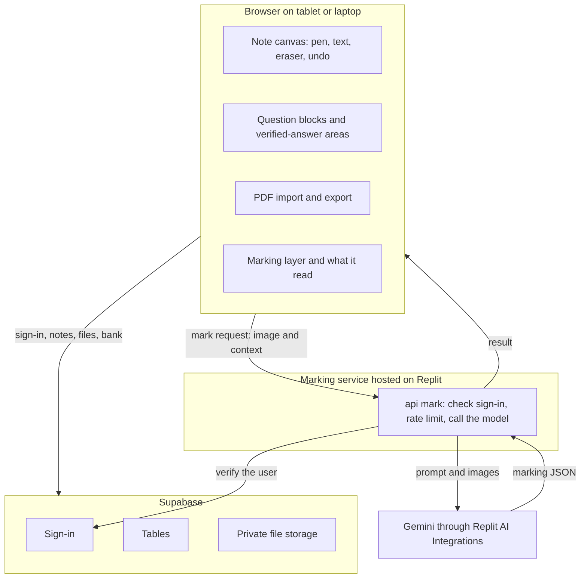
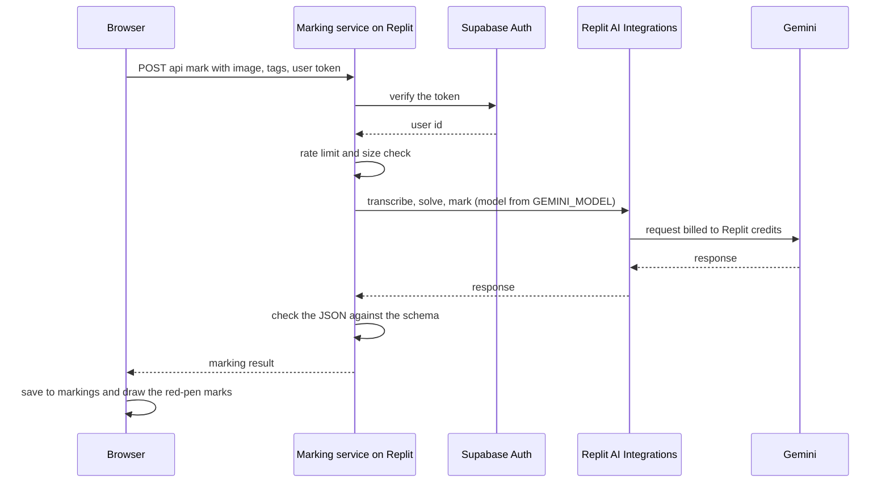
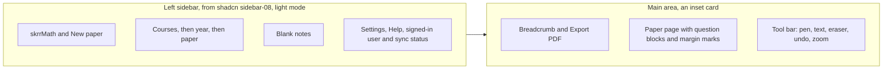
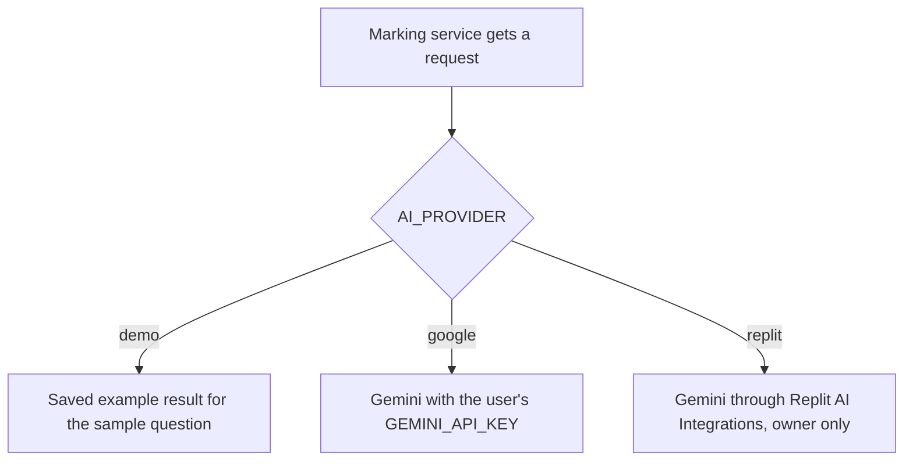

# Architecture

Everything here is proposed. Nothing has been built except a throwaway marking demo made in Replit.

## Parts

## The model call

## Parts in words

- **Canvas.** An existing drawing library supplies pen, eraser, undo, zoom, scroll, text and image paste. Not chosen. Check licences and tablet feel.
- **Question block.** A pasted crop or a box drawn on an imported PDF page. It carries course code, exam year and question number. The answer region is everything written below the block, up to the next block.
- **Verified-answer area.** A second writing area on a block. Handwriting, a pasted image or typed text.
- **Marking service.** A small separate app hosted on Replit, so that Replit AI Integrations can pay for the model calls. Claude Code builds it like the rest of the project. It receives the block image and answer region, the optional verified answer, and the course tags. Calls Gemini. Returns the marking result. The AI key never reaches the browser.
- **Supabase.** Sign-in, private tables for notes, files in private storage, and the shared bank table.

## Interface layout

The sidebar tree comes from the papers table (course code, exam year, paper). The shadcn block is a starting point and its exact contents are unchecked. The static mockup is `docs/mockup/index.html`.

## Data

Draft tables are in `supabase/schema.sql`. Summary:

| Table | Holds | Who can see it |
|---|---|---|
| papers | imported PDF info, file path, course and year | owner only |
| pages | strokes (JSON) per page | owner only |
| question_blocks | block position, tags, optional own reference | owner only |
| markings | marking result (JSON), status, label | owner only |
| bank_answers | tags, answer, who added, trust level | all signed-in users read, author edits |
| bank_confirmations | who confirmed an answer | signed-in users |
| bank_reports | reports of wrong answers | reporter and admin |

Files: PDFs and pasted images go to private storage under the owner's id. The shared bank never holds paper images.

## Flows

**Open a note.** Sign in. Load pages and blocks for the paper. Draw strokes on the canvas.

**Mark a block.**
1. The browser renders the block and its answer region to one image.
2. The server function receives it with any verified answer.
3. The AI transcribes, then solves or compares, then marks (see MARKING.md).
4. The result is saved to `markings` and drawn on the marking layer.

**Look up the bank (stage two).** On "mark", look up course, year and question number. If a bank answer exists, send it as the reference and show its trust level. If not, mark by AI reasoning and show "Not verified".

**Export.** Render each page with the marking layer to an image, then build a PDF in the browser.

## Security

- Row-level access rules on every table. Private tables: owner only. Test with two accounts.
- Service role key and AI key stay on the server.
- Optional email-domain limit on sign-in.
- Rate limit the mark endpoint. Each marking costs money.
- A report button on bank answers. Show who added each answer and how it was checked.
- Do not log image contents or answers.

## Hosting

The main app is built locally with Claude Code and its hosting is not decided. Only the marking service runs on Replit, because Replit AI Integrations are billed to Replit credits and the docs describe them for apps on Replit. Not tested: that a service deployed from a repository can use them, and how the main app proves to the service that a request is allowed (plan: the service verifies the Supabase sign-in token). If this does not work, run the same service anywhere with a Google AI Studio key.

## Providers

The hosted prototype uses `demo`. Visitors can mark only the sample questions. Real use needs the user's own key.

## Cost and speed (not verified)

The Replit demo cost about 0.01 per marking call (unit assumed to be dollars). The planned flow uses up to four calls when no verified answer exists, so up to about 0.04. Check the usage page.

## Risks

1. Reading messy handwriting.
2. Where one answer ends and the next block starts.
3. Correct work with different steps marked wrong.
4. Sync conflicts if two devices edit one page at once. Plan: autosave after a short pause, latest save wins.
5. Storage limits and the school's terms.
6. Overlap with Goodnotes Math Assist and with paper-marking apps.

## Open decisions

- Canvas library (tldraw or Excalidraw or other). Licence unchecked.
- Where the main app is hosted (not Replit by default).
- Whether Replit AI Integrations work for the marking service on the owner's account. The service must run without Replit by default (`AI_PROVIDER=google`).
- Google sign-in, and whether the school uses Google accounts.
- Store the PDF privately (option A) or re-import from the portal each time (option B). Option A planned.
- Whether per-line marks are possible. Needs a test of Gemini locating handwriting lines.
- Free-tier limits for Supabase and Gemini.
- App name and licence.
