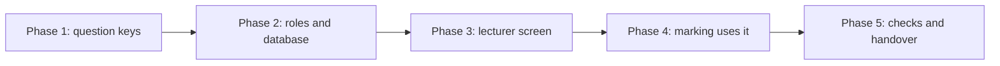

# Lecturer-verified solutions (option A)

Status (2026-11-06): option C is being built in four steps.
- Step 1, database: done. One answer book per paper (`0007_one_book_per_paper.sql`): the key is the course code and the exam, the `question` column is gone, a book can be up to 30000 characters of text or one picture. `scripts/bank-rls-test.mjs` passes again.
- Step 2, lecturer screen: done. A signed-in person taps Lecturer (bottom left), gives the code, then adds one book per paper (typed or a picture), changes it (text or picture, either way round), or withdraws it. `e2e/lecturer-screen.mjs`, 21 checks.
- Step 3, marking uses the book: done. When Mark is pressed and the student has no correct answer of their own, the app looks up a live book from the course name (when it looks like a code) and the note name, and sends it as the reference with a `book` flag. The service tells the AI it is an answer book, to find the question in it, and to report `book_match`. Found: the label reads "Checked against a lecturer's solution" and the AI does not solve the question itself. Not found: the service marks as if there were no book, so the label stays "AI-checked". The student's own correct answer wins over a book (D2, my proposal, not answered by the owner). Tests: 77 service tests, `e2e/book-lookup.mjs` (6 checks, no AI), and 3 real markings (in the book, correct and wrong; not in the book). Not done: a notice when the lecturer changes a book after a question was marked, a picture book through the real model, handwriting.
- Step 4, checks and handover: not started.
The phases below (1 to 5) are the earlier plan. Phase 1 (question labels) and decision D7 no longer apply. Written 2026-11-03 after the owner chose option A.

## Goal

A lecturer checks the solution to a past-paper question once. After that, every student's AI marks that question against the lecturer's solution. The label says so. This is the "lecturer-verified, shared across students" part of the stage-two bank in `PLAN.md`, cut down to what the owner asked for.

## In and out

In:
- Lecturer accounts (a role).
- A shared table of lecturer-verified solutions.
- A lecturer screen to add, change and withdraw a solution.
- Students' Mark finds the solution and uses it.
- A label that says "Checked against a lecturer's solution".

Out (option B and the rest of stage two):
- Reviewing individual AI markings.
- Flagging a wrong mark.
- Students adding answers, confirmations, reports, trust levels other than lecturer.

## Option C works in tests (2026-11-06): one answer book per paper

Instead of one solution per question with a question label, the lecturer adds ONE document per paper (course and exam). Marking sends the AI the question, the student's writing and the whole book, and the AI finds the matching solution itself. Tested on made-up typed questions: 12 of 12, then 14 of 14 with a 20-question book and with no question number in the image (`TEST-LOG.md`). If this is built, decision D7 (where the question label comes from) is no longer needed, and the database table changes from one row per question to one row per paper (the `question` column goes). Not yet tested: handwriting, a real long paper, a lecturer's book that is a picture. A wrong match is possible, so the result should say which solution was used.

## What this does not fix

A verified solution fixes "what is the right answer". It does not fix "what did the student write". Misreading handwriting is a separate problem (see `MARKING.md`).

## The phases

Each phase ends with a check, and the next one starts only after the owner has seen it.

### Phase 1: question keys (cut down: no screens, no typing for the student)

The owner said the course code box and the question label box were too much to type, and that nothing used them yet. They were removed on 2026-11-05. The rule from now on: **add nothing the student has to type.**

What is left is only the cleaning logic, in `shared/src/question-key.ts` (29 tests): `cleanExamLabel`, `cleanQuestionLabel`, `keyParts`, `questionKey`. The lecturer screen (phase 3) needs it, because the database only accepts cleaned keys.

Where each part of a key comes from, with no new typing:
- Course: the course name, when it looks like a code (the existing `normaliseCourseCode`; "uecm 2353" gives UECM2353). If the name is not a code, there is no match and nothing is shown. The student can simply name the course by its code.
- Exam: the note name, cleaned (D3: lowercase, no punctuation, words sorted).
- Question: see D7. This is the only part with no source yet.

Removed again: the course-code menu item, the label box, the key line, the saved labels, and the database column (`0005_drop_course_code.sql` drops what `0003` added).

### Phase 2: roles and database

Build:
1. A `profiles` table with a `role` (student or lecturer). A user can read their own row and cannot change their own role. The owner sets a lecturer by hand in Supabase.
2. A `bank_solutions` table: the key, the solution (text or a picture of the solution only, never a paper), who added it, a version number, when it was verified, and whether it is withdrawn.
3. Access rules:
   - any signed-in user can read a solution that is not withdrawn,
   - only a lecturer can add one,
   - a lecturer can change or withdraw only their own,
   - no one can change the role or the author from the app.
4. No column that stores a paper or question image.

Tests, with three accounts (student A, student B, lecturer):
- A student cannot add, change or delete a solution.
- A student cannot make themselves a lecturer.
- A lecturer can add, and can change only their own.
- Students A and B can both read it.
- A withdrawn solution is not returned.
- A signed-out visitor gets nothing.

Done when: all the checks pass, in the same style as `scripts/rls-test.mjs`.
Size: large. It is the riskiest phase, because a hole here exposes or corrupts shared data.

Built, with the owner's answers to D1 and D4 (`supabase/migrations/0004_lecturer_solutions.sql`, applied):
- `profiles` (role student or lecturer). A person reads only their own row. Nothing in the app can write a role.
- D1, the lecturer code: `LECTURER_CODE` in `.env`, stored as a salted bcrypt hash by `scripts/set-lecturer-code.mjs` (service role only). A signed-in person gives the code to `claim_lecturer(code)`, which returns `lecturer`, `wrong_code`, `locked` or `not_set`. Five wrong tries in an hour lock that person for an hour. The hash and the attempts are not readable by anyone in the app.
- `bank_solutions`: the key (course code, exam, question, shaped by checks), text or a picture of the solution only, the lecturer, a version number that goes up on every change, `withdrawn`, and times. One live solution per key.
- D4, access: every signed-in user reads live solutions. Only a lecturer adds, as themselves. Only the author changes or withdraws it, and only while still a lecturer. The key and the author cannot change. No delete.
- Test: `scripts/bank-rls-test.mjs`, 4 temporary accounts (2 students, 2 lecturers), 58 checks including the code and the lock. When no code is stored, it stores a throwaway one for the test and removes it.
- Not done in this phase: any screen. A person cannot yet claim the code in the app (phase 3).

### Phase 3: lecturer screen

Build:
1. A lecturer-only area (not shown to students) to pick a key (course code, exam, question label) and add a solution as typed text or a picture.
2. A list of the lecturer's own solutions, with change and withdraw.
3. A short line saying it will be visible to every signed-in student.

Done when: a lecturer can add, change and withdraw a solution, and a student never sees the screen.
Size: medium.

### Phase 4: marking uses it

Build:
1. On Mark, the app looks up the key. If a solution exists, it is sent as the reference. If the student has their own correct answer, see decision D2.
2. The result label: "Checked against a lecturer's solution". This uses the existing `verified_bank` source in the result, with the label changed.
3. A notice if the lecturer changed the solution after the question was marked (the solution has a version number, saved with the mark).
4. If no solution is found, nothing changes: the AI solves it and the label stays "AI-checked".

Tests: the label for each case, the lookup with and without a match, a withdrawn solution is not used, an updated solution shows the notice. One real marking check on the owner's ODE page with a lecturer solution.
Done when: a second student, on another account, gets the lecturer's solution used without doing anything.
Size: medium.

### Phase 5: checks and handover

1. Walk through with three real accounts (two students, one lecturer) on the tablet and laptop.
2. Write how a lecturer gets set up (README).
3. Re-run all the access tests.
4. Record the results in `TEST-LOG.md`.

## Decisions for the owner

These are open. Nothing is assumed.

- D1 (answered 2026-11-03). How does someone become a lecturer? The owner chose a preset code in `.env`. Built in phase 2.
- D2. A student has their own correct answer and a lecturer solution exists. Which wins? Proposal: the student's own answer wins, because they chose to add it, and the label says whose it is.
- D3. How are exams matched? Notes are free text ("2023 May", "May 2023"). Proposal: a cleaning rule (lowercase, no punctuation, words sorted) plus a pick-list of the exams that already have a solution, so students pick instead of type.
- D4 (answered 2026-11-03). Who can read a solution? Every signed-in student, as proposed.
- D5. Copyright and school rules about sharing solutions. Not checked. The owner or the lecturer should check before real use.
- D7. Where does the question label come from, with no typing? Proposal: when the student presses Mark, the AI reads the question number from the pasted question image (the marking already reads that image), the app uses it for the lookup, and shows one small line, for example "Using the lecturer's solution for 23a", so a wrong match is visible. The student can turn it off. Needs a test on real question images, because a wrong number would use the wrong solution.
- D6. Can a lecturer add a handwritten solution on the canvas? Proposal: no, typed text or a picture first.

## Risks

- Wrong or mistyped keys: a student gets no match and the AI solves it. This is safe, but it can look like the feature is broken. Phase 1 and the pick-list reduce it.
- A wrong lecturer solution is used by every student. The lecturer can fix or withdraw it. There is no student report in this option.
- Access rules: a mistake here shows or changes shared data. Phase 2 has its own tests and is not skipped.
- Roles by hand: fine for a small test, not for many lecturers.
