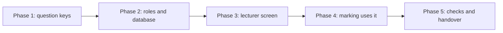

# Lecturer-verified solutions (option A)

Status: phase 1 is built (2026-11-03). Phases 2 to 5 are not started. Written 2026-11-03 after the owner chose option A.

## Goal

A lecturer checks the solution to a past-paper question once. After that, every student's AI marks that question against the lecturer's solution. The label says so. This is the "lecturer-verified, shared across students" part of the stage-two bank in `PLAN.md`, cut down to what the owner asked for.

## In and out

In:
- Lecturer accounts (a role).
- A shared table of lecturer-verified solutions.
- A lecturer screen to add, change and withdraw a solution.
- Students' Mark finds the solution and uses it.
- A label that says "Checked against a lecturer's solution".

Out (option B and the rest of stage two):
- Reviewing individual AI markings.
- Flagging a wrong mark.
- Students adding answers, confirmations, reports, trust levels other than lecturer.

## What this does not fix

A verified solution fixes "what is the right answer". It does not fix "what did the student write". Misreading handwriting is a separate problem (see `MARKING.md`).

## The phases

Each phase ends with a check, and the next one starts only after the owner has seen it.

### Phase 1: question keys

Why first: a solution can only be found if the student's question and the lecturer's solution have the same key. The key is course code, exam, question label.

Build:
1. A course code on each course (separate from its display name), cleaned by one shared function (for example "uecm 2323" and "UECM2323" are the same).
2. The exam is the note name, cleaned the same way ("2023 May" and "may 2023" need a rule, see decision D3).
3. A question label on each question (for example "23a"), typed once, saved with the note. It starts empty and the marking works without it. The bank lookup needs it.
4. One function in `shared/` that makes the key, with tests.

Done when: each question shows its key, and the same question typed two ways gives one key.
Size: small to medium.

Built, as follows. The exam rule is the proposal in D3 (lowercase, no punctuation, words sorted), still waiting for the owner's answer.
- `shared/src/question-key.ts`: `cleanExamLabel`, `cleanQuestionLabel`, `keyParts`, `questionKey`, `missingKeyParts`. 29 tests.
- A course code on each course: `courseCode` in the list (`shared/src/papers.ts`), `courses.course_code` in the database (`supabase/migrations/0003_course_code.sql`, applied). Set by hand in the course's menu ("Course code"). If it is not set, it is worked out from the name when the name looks like a code ("uecm 2353" gives UECM2353). The guest's code goes up at sign-in.
- A question label box on each question, saved with the note (`pages.strokes.labels`).
- The question shows its key, or what it still needs.
- Tested: 170 shared tests and `e2e/question-keys.mjs` (13 checks).

### Phase 2: roles and database

Build:
1. A `profiles` table with a `role` (student or lecturer). A user can read their own row and cannot change their own role. The owner sets a lecturer by hand in Supabase.
2. A `bank_solutions` table: the key, the solution (text or a picture of the solution only, never a paper), who added it, a version number, when it was verified, and whether it is withdrawn.
3. Access rules:
   - any signed-in user can read a solution that is not withdrawn,
   - only a lecturer can add one,
   - a lecturer can change or withdraw only their own,
   - no one can change the role or the author from the app.
4. No column that stores a paper or question image.

Tests, with three accounts (student A, student B, lecturer):
- A student cannot add, change or delete a solution.
- A student cannot make themselves a lecturer.
- A lecturer can add, and can change only their own.
- Students A and B can both read it.
- A withdrawn solution is not returned.
- A signed-out visitor gets nothing.

Done when: all the checks pass, in the same style as `scripts/rls-test.mjs`.
Size: large. It is the riskiest phase, because a hole here exposes or corrupts shared data.

### Phase 3: lecturer screen

Build:
1. A lecturer-only area (not shown to students) to pick a key (course code, exam, question label) and add a solution as typed text or a picture.
2. A list of the lecturer's own solutions, with change and withdraw.
3. A short line saying it will be visible to every signed-in student.

Done when: a lecturer can add, change and withdraw a solution, and a student never sees the screen.
Size: medium.

### Phase 4: marking uses it

Build:
1. On Mark, the app looks up the key. If a solution exists, it is sent as the reference. If the student has their own correct answer, see decision D2.
2. The result label: "Checked against a lecturer's solution". This uses the existing `verified_bank` source in the result, with the label changed.
3. A notice if the lecturer changed the solution after the question was marked (the solution has a version number, saved with the mark).
4. If no solution is found, nothing changes: the AI solves it and the label stays "AI-checked".

Tests: the label for each case, the lookup with and without a match, a withdrawn solution is not used, an updated solution shows the notice. One real marking check on the owner's ODE page with a lecturer solution.
Done when: a second student, on another account, gets the lecturer's solution used without doing anything.
Size: medium.

### Phase 5: checks and handover

1. Walk through with three real accounts (two students, one lecturer) on the tablet and laptop.
2. Write how a lecturer gets set up (README).
3. Re-run all the access tests.
4. Record the results in `TEST-LOG.md`.

## Decisions for the owner

These are open. Nothing is assumed.

- D1. How does someone become a lecturer? Proposal: the owner sets the role by hand in Supabase. A course invite code can come later.
- D2. A student has their own correct answer and a lecturer solution exists. Which wins? Proposal: the student's own answer wins, because they chose to add it, and the label says whose it is.
- D3. How are exams matched? Notes are free text ("2023 May", "May 2023"). Proposal: a cleaning rule (lowercase, no punctuation, words sorted) plus a pick-list of the exams that already have a solution, so students pick instead of type.
- D4. Who can read a solution? Proposal: every signed-in student. There is no course membership in the app yet.
- D5. Copyright and school rules about sharing solutions. Not checked. The owner or the lecturer should check before real use.
- D6. Can a lecturer add a handwritten solution on the canvas? Proposal: no, typed text or a picture first.

## Risks

- Wrong or mistyped keys: a student gets no match and the AI solves it. This is safe, but it can look like the feature is broken. Phase 1 and the pick-list reduce it.
- A wrong lecturer solution is used by every student. The lecturer can fix or withdraw it. There is no student report in this option.
- Access rules: a mistake here shows or changes shared data. Phase 2 has its own tests and is not skipped.
- Roles by hand: fine for a small test, not for many lecturers.
