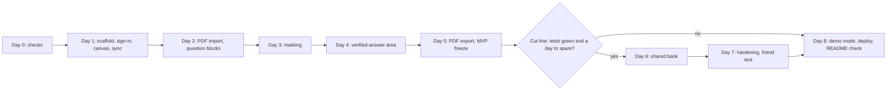
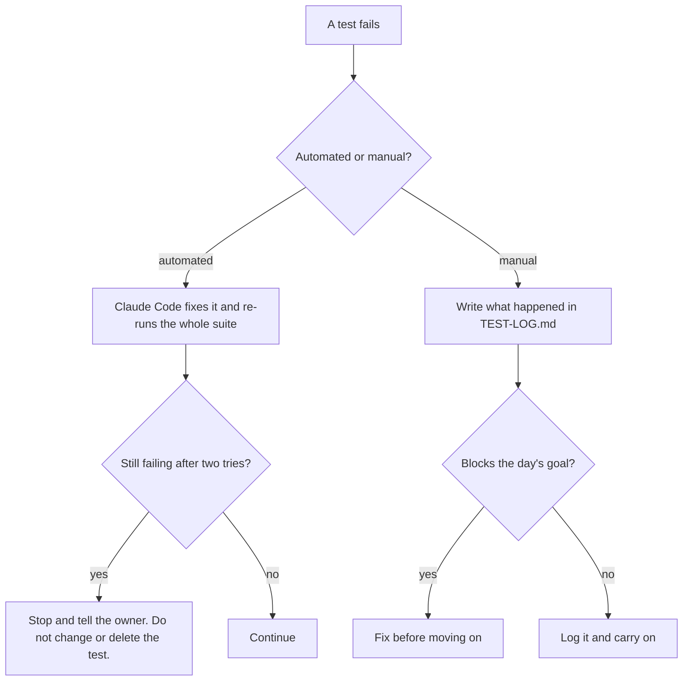

# Plan

One person, a self-set target of 8 days, plus a half-day of checks before day 1. Claude Code builds the project and runs the automated tests. The owner runs the manual tests on a real tablet and laptop. A day is done only when both kinds of test pass.

Everything here is proposed. Test tools are suggestions: Vitest for unit tests, Playwright for browser tests. Exact commands are filled in when the project is scaffolded.

## How testing works

| Kind | Who | Where | Rule |
|---|---|---|---|
| Automated | Claude Code | Runs on this machine, no keys by default | Must pass before the day is called done. Tests that need the network or a key are skipped unless the owner turns them on. |
| Manual | Owner | Real tablet with stylus, and laptop | Follow the steps. Write the result in `docs/TEST-LOG.md` as pass, fail or partly, with the date and a note. |

Rules for the test files:
- Fixtures (sample PDFs, images, saved marking results) are the owner's own work or made-up questions. Never copy text from the school's papers into the repo.
- The AI is never called in automated tests. A mock model returns scripted replies. One optional live test per AI feature exists and is off by default.
- A test that fails is fixed or the failure is written down. No test is deleted to make a day pass.

## Day 0: checks before building (about half a day)

| Check | Who | How | Pass means |
|---|---|---|---|
| Replit credits reach a separate service | Owner | The minimal Replit server test from the chat: call it with `curl` from the laptop, then read the usage page | A reply comes back and a small charge shows. If not, plan on `AI_PROVIDER=google` with a Google AI Studio key. |
| Supabase free-tier limits | Owner | Read the plan page: storage, rows, bandwidth, pausing of idle projects | Limits are written in `docs/TEST-LOG.md`. A student with 30 papers fits, or the plan changes. |
| School terms on storing papers | Owner | Read the portal terms or ask a lecturer | Written decision: store privately, or re-import each time (option B in ARCHITECTURE.md). |
| Can Gemini locate handwritten lines | Claude Code | Done 2026-11-01 on page 2 through `/api/locate`. | Passed: 17 of 17 boxes on the right line. Per-line marks are a go, with a margin added to each box, and a test on more pages. |
| Stylus feel in a browser | Owner | Excalidraw on the tablet (done, felt normal). Repeat with the chosen canvas library on day 1. | No lag, no palm marks. |
| Canvas library licence | Claude Code | Read the library's licence for this use | Written in `docs/TEST-LOG.md`. |

## Day 1: scaffold, sign-in, canvas, sync

**Build**
1. Repository layout: `web` (Vite, React, TypeScript), `marking-service` (Node, TypeScript), `shared` (marking JSON types and validation).
2. Tooling: TypeScript strict mode, lint, Vitest, Playwright, a script that loads `.env` and stops with a clear message when a required value is missing.
3. Two Supabase projects: one for development, one for tests. Apply `supabase/schema.sql` to both after reviewing it.
4. Sign-in (Google, with an optional email-domain limit).
5. Add shadcn/ui and the `sidebar-08` block with `npx shadcn@latest add sidebar-08`, then change it to a course, year and paper tree in light mode with the app name skrrMath. Read the generated files before editing.
6. Canvas with pen, text, eraser, undo, zoom, scroll. Spend one hour comparing two libraries on the tablet before picking.
7. Save and load a page. Autosave a few seconds after writing stops. Latest save wins.

**Automated tests (Claude Code)**
- Env loader: missing required value gives a clear error. `.env.example` lists every variable the code reads.
- Shared schema: a valid sample marking JSON passes. Missing fields, unknown verdicts and wrong types fail.
- Access smoke test with two test users: user B cannot read or change user A's page.
- Browser test: the app loads, shows sign-in, and a signed-in test user can save and reload a stroke.
- Autosave: a changed page is sent once after the pause, not on every stroke (mock timer).
- Sidebar: renders the course, year and paper tree from sample data, expands and collapses, highlights the open paper, and shows the app name skrrMath.

**Manual tests (owner)**
1. Sign in on the tablet and on the laptop with the same account.
2. On the tablet, write five lines with the stylus. Rest your palm on the screen while writing.
3. Wait ten seconds. Open the same page on the laptop. Check: all strokes are there, in the same place.
4. Add one line on the laptop. Refresh the tablet. Check: the line appears.
5. Look at the sidebar on the tablet and the laptop. Check it matches the mockup in layout, expands and collapses by touch, and the text is readable in light mode.
6. Turn off Wi-Fi on the tablet, write a line, turn it back on. Check: nothing is lost, or the app tells you it did not save.

**Done when:** all of the above pass and the canvas choice and its licence are written down.
**If it fails:** if sync is unreliable, stop and fix it. Everything after this depends on it.

## Day 2: PDF import and question blocks

**Build**
1. Import a PDF with pdf.js. Store it in private storage under the owner's id. Show its pages.
2. Make a question block two ways: draw a box on a PDF page, or paste a cropped screenshot into a note.
3. Tags on each block: course code (drop-down of the user's existing courses, plus add new), exam year, question number. Normalise typed course codes (for example "Math 201" becomes "MATH201").
4. Compute the answer region: from the block's bottom edge to the top of the next block, or the end of the page.
5. A debug outline that shows the answer region while testing.

**Automated tests**
- `answerRegion`: one block, two blocks, a block at the bottom of the page, two blocks very close, a block that overlaps another, and blocks on different pages.
- Tag normalisation: "math201", "Math 201", " MATH-201 " all give one canonical code. Empty and odd inputs are rejected.
- Browser test with a made-up three-page PDF fixture: import, draw a box, set tags, reload, and the block is still there.
- Private storage: user B cannot download user A's PDF.
- Crop: the saved block image has the size of the box drawn (within a pixel).

**Manual tests**
1. Import one of your own school PDFs (do not commit it). Check the pages are sharp.
2. Draw a box around question 1 with the stylus. Do the same for question 2. Check the boxes fit the questions.
3. Paste a cropped screenshot of a question into a blank note. Check it becomes a block.
4. Write an answer below each block. Turn on the debug outline. Check each region ends where the next block starts.
5. Set tags. Check the course drop-down remembers the course on the next block.

**Done when:** blocks work from both sources, and the regions are correct in your own real paper.
**If it fails:** if regions are wrong in real papers, let the owner draw the end of each answer by hand. Do not guess.

## Day 3: marking

**Build**
1. `marking-service` endpoint `POST /api/mark`. It checks the sign-in token, limits request size and type, applies a per-user rate limit, then calls the provider chosen by `AI_PROVIDER` (`demo`, `google`, `replit`).
2. The pipeline from `docs/MARKING.md`: transcribe, solve independently twice, check lines, mark the first error, set statuses.
3. Validate the reply against the shared schema. On invalid JSON, retry once, then return status `unreadable`.
4. Rules in code, not only in the prompt: at most one `error` line (the first), lines after it that are not ok become `follows_from_error`, and if the two solves disagree the status is `unsure` and the final answer is not judged.
5. UI: Mark button on each block, red-pen margin marks, the "AI-checked" label, the "what it read" view, a switch to hide marks, saving the result with the block.
6. Demo fixtures: a saved marking result for one made-up question.

**Automated tests**
- Provider switch: `demo` returns the fixture and makes no network call. `google` without a key fails with a clear message. An unknown value fails at start.
- Auth: no token or a bad token gives 401. Oversize or wrong file type gives 4xx.
- Rate limit: the request over the limit gets 429, and another user is not affected.
- Mock model returns broken JSON: one retry, then status `unreadable`.
- Mock model returns two lines marked error: the code keeps the first and converts the rest.
- Two mock solves disagree: status `unsure`, final answer `unknown`, and no error is invented.
- A line the model flags as unreadable stays unmarked.
- Rendering: given a fixture result, the browser shows a cross at the right row, a soft note on later rows, the label, and hides marks when the switch is off.
- Optional live test (off by default, needs a key): mark the owner's page 2 image and assert the first error is the sign line and the status is `marked`.

**Manual tests**
1. In `demo` mode: mark the example. Check the marks appear in the margin beside the right lines, the label reads "AI-checked", "what it read" opens, and the switch hides the marks.
2. With your key or Replit credits, run page 1, page 2 and page 4 with their questions cropped back in. Compare to the expected results in `docs/MARKING.md`. Record each as pass or fail.
3. Look at the usage page after five markings. Write the cost per marking in `docs/TEST-LOG.md`. Also write the time per step (transcribe, solve, mark) and the total. Mark it a fail if a full marking takes longer than 30 seconds without a progress display.
4. Write one line badly on purpose. Check it says it cannot read the line and does not judge it.
5. Mark the same page twice. Check the result is stable, or note how much it changes.

**Done when:** pages 1, 2 and 4 behave as expected, the cost is known, and the unreadable and unsure cases show up in the UI.
**If it fails:** if marking is unreliable on real pages, narrow to one question type before going on. Do not hide the failure behind a confident label.

## Day 4: verified-answer area

**Build**
1. A verified-answer area on each block with three inputs: handwriting, a pasted image, or typed text.
2. Marking uses it when present. The label changes to "Checked against your answer".
3. The request builder sends the reference image or text with the block.

**Automated tests**
- Reference choice: a user's own reference beats `ai_solved`. A bank answer (day 6) will beat both. Table-driven test.
- Label mapping for each reference source.
- The reference is sent to the model and is not included when absent (mock model sees the exact request).
- The reference is saved with the block and reloads.
- Browser test: add a typed reference, mark in demo mode with a fixture, and the label changes.

**Manual tests**
1. Mark a question without a reference, then add your own worked solution and mark again. Compare the two and the labels.
2. Different-route test: write a correct solution that uses different steps from the reference. It must not be marked wrong. Record pass or fail. This is the failure most likely to hurt trust.
3. Put a deliberately wrong reference in. Check the label still tells you whose answer it used.
4. Paste a photo of a solution as the reference. Check it is read.

**Done when:** labels are right in all cases and the different-route test result is written down, whether it passes or not.

## Day 5: PDF export and MVP freeze

**Build**
1. Export the marked paper as a PDF with the writing and the marks. An option to leave the marks out.
2. README setup steps, written as someone new would follow them.
3. MVP freeze: no new features until the cut line decision.

**Automated tests**
- Export of a three-page paper gives a PDF with three pages.
- With marks on, a rendered page differs from the version with marks off, in the margin area only.
- File size stays under a limit (set after measuring).
- Browser test: click Export, and a file downloads.
- The full test suite passes from a clean checkout.

**Manual tests**
1. Export a marked paper on the tablet. Open the PDF on the phone and the laptop. Check handwriting and marks are readable.
2. Print preview one page. Check nothing is cut off.
3. Export with marks off. Check it is the clean paper.
4. Walk through the whole MVP once as a student: import, make blocks, write, mark, add a reference, export. Time it and write down every rough spot.

**Cut line check**
- [ ] All automated tests pass.
- [ ] Manual log has no open failure on days 1 to 5.
- [ ] You have a full day to spare.

If any box is empty, skip days 6 and 7, fix what is open, and go to day 8.

## Day 6: shared bank (stage two)

**Build**
1. Bank CRUD through Supabase, with the access rules in `schema.sql`.
2. On "mark", look up the bank by course, year and question number. If an answer exists, use it as the reference and show its trust level.
3. "Add to the bank" on a verified answer, with a short consent line saying it will be visible to signed-in students.
4. A server function that counts confirmations and changes the trust level. The client cannot set it.
5. Report button.

**Automated tests (two test users)**
- User A adds an answer. User B can read it. B cannot edit or delete it.
- Inserting with trust level `tutor` or `confirmed` from the client is rejected.
- A cannot confirm their own answer. A second confirmation from the same user is rejected.
- After the set number of confirmations, the server changes the level to `confirmed`. Choose the number first (proposed: 2).
- Lookup returns the highest trust level when several answers exist.
- The bank tables have no column that stores paper or question images.

**Manual tests**
1. Account A on the tablet adds an answer. Account B on the laptop marks the same tags. Check B sees "added by a student, not checked".
2. B confirms. Check the label changes after the set number of confirmations.
3. B reports the answer. Check the report is saved and A is not told who reported.
4. Try a tag typo ("Math201") and check the drop-down or normalisation puts it in the same bank.

**Done when:** a second person benefits from the first person's answer, and the client cannot raise a trust level.
**If it fails:** stop the bank and ship without it. Do not ship a bank with a hole in the access rules.

## Day 7: hardening and friend test

**Build**
1. Review every access rule against `schema.sql`. Add tests for any gap.
2. Error and empty states: offline, the AI is down, the AI is slow, nothing marked yet, a new account with no papers.
3. A short privacy note: handwriting images go to the AI service when you press mark, and are not stored by the app. Say who can see what.
4. Remove image contents and answers from logs.

**Automated tests**
- Full access-rule suite across every table, two users.
- Secrets scan: the built web bundle contains no service-role key and no AI key. Run a search for known patterns.
- Logs: a mark request in a test run writes no image data or answer text to the log.
- AI timeout: a slow mock model shows an error and lets the user retry.
- Dependency audit report is produced and reviewed.

**Manual tests**
1. Ask three friends to do two questions each, without help. Watch. Write down time to first mark, misreads, and anything confusing.
2. Check Supabase usage after the test and compare with the free-tier limits from day 0.
3. Sign in with a second account and try to open the first account's paper by guessing its address. It must fail.
4. Read the privacy note as a stranger. Does it say what happens to the images?

**Done when:** no friend is blocked, and the top three problems are fixed or written down.

## Day 8: demo mode, deploy, handover

**Build**
1. Demo mode: `AI_PROVIDER=demo` returns the saved example results. Fixtures are made-up or the owner's own work.
2. Deploy the prototype in demo mode. Real use needs the user's own Gemini key.
3. Check the README from a clean clone.
4. Choose a licence and add it.

**Automated tests**
- Clean-clone test: fresh directory, install, copy `.env.example` to `.env` with `AI_PROVIDER=demo`, run the tests, start the app.
- Demo mode makes zero outbound AI calls (a network guard fails the test if one is attempted).
- The full suite passes.

**Manual tests**
1. Open the deployed link on the tablet. Run the example from start to finish.
2. Check the Gemini and Replit usage pages show no new calls from the deployed prototype.
3. Open the link from a different network and a phone.
4. Follow the README on a second machine, or with a friend, to run the real version with their own key.

**Done when:** the deployed prototype works on your tablet, calls no AI, and a friend can run the real version from the README.

## If a test fails

## If behind

1. Drop typed input in the verified-answer area, then pasted images.
2. Drop PDF export.
3. At the cut line, skip the bank and hardening extras, and go to day 8.

Never skip the "AI-checked" label, the access rules, or the secrets check.

## Cost log

Write one line after each day with the cost shown on the usage page and the number of markings. Compare with the plan's estimate of up to four calls per marking.
